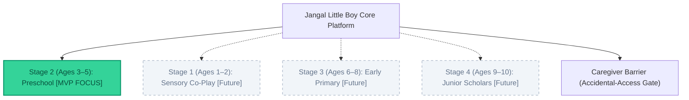
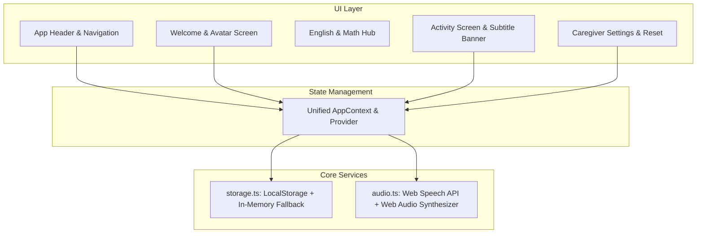

# Jangal Little Boy: Product Discovery & Technical Architecture Plan

**Document Version:** 2.2.0 (Complete Learning Curriculum & Architecture Blueprint)  
**Status:** Approved  
**Role:** Senior Product Analyst & Software Architect  

---

## 1. Problem Understanding & Cultural Context

### 1.1 The Educational Challenge for Preschoolers (Ages 3–5)
Preschool children are in Piaget’s preoperational developmental phase:
- **Non-Readers:** They rely primarily on visual and auditory cues; text cannot be the primary navigation mechanism.
- **Motor Development:** Children interact with tablets and smartphones using single-finger taps or broad presses; small buttons, tight margins, and hover states lead to frustration.
- **Emotional Feedback:** Children thrive on immediate, joyful reinforcement. Negative failure cues (such as red buzzers or "Game Over" screens) induce anxiety and disengagement.
- **Privacy & Safety:** Commercial apps frequently harvest device identifiers, display ads, or require unnecessary account creation, conflicting with child privacy standards (COPPA, GDPR-K).

### 1.2 Cultural Context: The Meaning of "Jàngal"
The project name **Jangal Little Boy** is rooted in the **Wolof** language, where ***Jàngal*** means **"to teach"** or **"to educate"** (and *Jàng* means "to learn" or "to read"). 

The application embraces this educational ethos:
- Warm, joyful, and welcoming visuals (warm sun golds, sky blues, earthy terracottas, and vibrant greens).
- Friendly character avatars (curious, cheerful young learners).
- A positive, community-oriented mentorship feel where every learning step is celebrated with warmth and dignity.
- Free of generic jungle clichés or stereotypes.

---

## 2. Proposed Solution

A clean, responsive, touch-first Single Page Application (SPA) built with **React 19**, **Vite**, and **Tailwind CSS**, designed with the following principles:

1. **Targeted Preschool MVP (Ages 3–5):** Tailored activities for English (Alphabet Phonics, CVC Word Match) and Mathematics (Counting 1–10, Shapes & Colours).
2. **Simplified, Scalable State Architecture:** A single, lean `AppContext` avoiding premature over-abstraction while retaining full flexibility to scale to older cohorts (Ages 1–2, 6–8, 9–10) in future phases.
3. **Resilient Audio Subsystem with Visible Subtitles:** Native **Web Speech API** for spoken instructions and phonics, complemented by low-latency **Web Audio API** synthesized chimes, with an automatic **visual subtitle banner** fallback when speech synthesis is blocked or unavailable.
4. **Privacy-by-Design & Zero-PII:** No personal data collected. Child name is strictly optional (defaults to a friendly nickname like "Little Explorer"). All data is stored strictly on the local device.
5. **Preserved Accessibility:** Large touch targets ($\ge 64\text{px}$–$80\text{px}$) without disabling native browser pinch-to-zoom.
6. **Accidental-Access Caregiver Barrier:** A lightweight interaction barrier (arithmetic question or 3-second hold) designed to prevent toddlers from leaving the learning screen or resetting progress by mistake.

---

## 3. Target Users & Age-Group Architecture



### 3.1 MVP Core: Stage 2 (Ages 3–5 - Preschool)
- **Cognitive Profile:** Symbolic play, letter-sound association, concrete quantity recognition (1–10), shape/color categorization.
- **Motor Profile:** Direct touch, single-finger taps, gross motor movements on tablets/phones.
- **Pedagogical Scope:**
  - *English:* Letter recognition (uppercase and lowercase), phonemic awareness (letter sounds), and decodable **CVC (Consonant-Vowel-Consonant)** words (e.g., *cat*, *sun*, *bus*, *dog*).
  - *Math:* 1-to-1 correspondence counting (1 to 10), numeral recognition, and identifying 5 fundamental shapes (**Circle, Square, Triangle, Rectangle, Star**) and 5 primary/secondary colors (**Red, Blue, Green, Yellow, Orange**).
- **Feedback Loop:** Zero failure states. Incorrect taps trigger a gentle visual wiggle and an encouraging prompt to try again.

### 3.2 Extensibility for Future Age Stages
Future age modules plug directly into the curriculum engine without altering the core UI shell:
- **Stage 1 (Ages 1–2):** Sensory tap-and-react audio boards with caregiver co-play conversation prompts.
- **Stage 3 (Ages 6–8):** Sight word mastery, spelling, addition/subtraction, and number comparisons.
- **Stage 4 (Ages 9–10):** Multi-step problem solving, multiplication, division, fractions, and grammar challenges.

---

## 4. Complete Learning Curriculum

The application provides two primary learning areas: **English** and **Mathematics**.

The curriculum supports progressive learning based on the child's age, developmental stage, and learning level. Learning content progresses from simple foundational concepts to more advanced concepts rather than introducing every topic at once.

### 4.1 A. English Curriculum

English introduces foundational language and literacy skills through visual learning, listening, pronunciation, interactive exercises, and age-appropriate reading activities.

1. **Alphabet Recognition:**
   - Introduce uppercase and lowercase letters A–Z.
   - Associate each letter with familiar words.
   - Include relevant picture illustrations.
   - Allow children to hear letter names and associated words.
   - Support letter identification and recognition.
2. **Letter Sounds and Phonics:**
   - Introduce basic letter sounds.
   - Connect letters with their corresponding sounds.
   - Introduce simple sound combinations.
   - Provide listening and repetition activities.
3. **Vocabulary Development:**
   - Introduce everyday vocabulary using familiar objects, animals, food, people, and environments.
   - Display words alongside relevant illustrations.
   - Provide audio pronunciation.
   - Organize vocabulary into understandable themes.
4. **Word Recognition:**
   - Introduce simple words progressively.
   - Connect written words with their corresponding pictures.
   - Include word identification and matching activities (e.g., CVC decodable words).
5. **Spelling:**
   - Introduce simple spelling exercises.
   - Allow children to identify missing letters.
   - Support letter arrangement and simple word formation.
6. **Reading:**
   - Introduce simple words and progressively longer reading material.
   - Include short, age-appropriate passages.
   - Support reading through audio narration and visual illustrations.
7. **Grammar:**
   - Introduce foundational grammar concepts progressively: nouns, verbs, adjectives, pronouns, basic punctuation, and simple grammatical structures.
8. **Sentence Construction:**
   - Introduce simple sentence structures.
   - Teach children how words combine to form sentences.
   - Include word arrangement exercises.
   - Introduce capital letters and punctuation appropriately.
9. **Reading Comprehension:**
   - Introduce short, age-appropriate stories and passages.
   - Include simple comprehension questions.
   - Encourage children to identify characters, objects, and events.
   - Support understanding through pictures and audio.

### 4.2 B. Mathematics Curriculum

Mathematics develops foundational numerical understanding, logical thinking, and problem-solving skills through visual demonstrations and interactive activities.

1. **Number Recognition:**
   - Introduce numbers progressively.
   - Teach number identification.
   - Associate numbers with visual quantities.
   - Support number pronunciation.
2. **Counting:**
   - Introduce counting progressively (1 to 10 in Early Foundation).
   - Use familiar objects to represent quantities.
   - Include interactive counting exercises (1-to-1 correspondence tap-to-count).
   - Support forward and backward counting when developmentally appropriate.
3. **Shapes and Colours:**
   - Introduce foundational shapes: **Circle, Square, Triangle, Rectangle, Oval** (and Star).
   - Introduce foundational colours using recognizable visual examples.
   - Include shape and colour identification activities.
4. **Number Comparison:**
   - Introduce greater than, less than, and equal to.
   - Compare visual quantities.
   - Help children understand more, fewer, and equal amounts.
5. **Addition:**
   - Introduce addition using visual objects.
   - Use simple number combinations.
   - Progress towards basic numerical addition.
6. **Subtraction:**
   - Introduce subtraction through removing objects from a group.
   - Use visual demonstrations.
   - Progress towards basic numerical subtraction.
7. **Multiplication:**
   - Introduce multiplication through repeated addition.
   - Use groups of objects and visual representations.
   - Progress towards basic multiplication exercises.
8. **Division:**
   - Introduce division through sharing objects equally.
   - Use simple visual demonstrations.
   - Progress towards age-appropriate division exercises.
9. **Fractions:**
   - Introduce foundational fractions such as halves and quarters.
   - Use visual representations of divided shapes and objects.
   - Help children understand equal and unequal parts.
10. **Mathematical Reasoning:**
    - Introduce simple mathematical puzzles.
    - Encourage logical thinking.
    - Include age-appropriate word problems.
    - Support practical, everyday mathematical understanding.

### 4.3 C. Progressive Learning Levels

The curriculum is organized into three progressive levels (age ranges are guidelines based on ability, not strict locks):

- **Level 1: Early Foundation (Ages 3–5) [MVP FOCUS]:**
  - *English:* Alphabet recognition, basic phonics, familiar vocabulary, simple matching activities (CVC words).
  - *Math:* Number recognition, 1-to-1 counting (1 to 10), shapes (Circle, Square, Triangle, Rectangle, Oval, Star) and colours.
- **Level 2: Developing Foundation (Ages 5–7):**
  - *English:* Word recognition, basic spelling, early reading, simple sentence construction, foundational grammar.
  - *Math:* Number comparison, addition and subtraction, introductory multiplication.
- **Level 3: Expanding Knowledge (Ages 7–10):**
  - *English:* Reading comprehension, advanced vocabulary, spelling development, grammar, sentence construction, basic writing.
  - *Math:* Multiplication and division, fractions, mathematical reasoning.

### 4.4 D. Educational Implementation Requirements

- **Clear Educational Objectives:** Every learning topic must have a distinct pedagogical purpose.
- **Progression from Simple to Complex:** New concepts scaffold upon previously mastered foundations.
- **Developmental Appropriateness:** Content, interaction mechanics, and touch sizing must match the child's developmental stage.
- **Visual Demonstrations & Rich Audio:** Visual cues accompanied by clear audio narration, pronunciation, and visible subtitles.
- **Interactive Reinforcement:** Zero-punishment tactile exercises reinforcing positive discovery.
- **Extensible Architecture:** Educational content in structured data layers so additional levels/lessons plug in without redesigning the core application.
- **MVP Prioritization:** Prioritize Level 1 (Early Foundation) while keeping the architecture prepared for Level 2 and Level 3 expansions.

### 4.5 Feature Matrix: MVP vs. Progressive Expansion

| Feature Area | In MVP (Level 1: Ages 3–5) | Postponed to Future Progressive Levels (Levels 2 & 3) |
| :--- | :--- | :--- |
| **Target Audience** | **Early Foundation (Ages 3–5)** | Developing Foundation (5–7), Expanding Knowledge (7–10) |
| **English Curriculum** | • **Alphabet & Phonics Explorer** (A–Z uppercase/lowercase, sounds, words)<br/>• **CVC Word & Picture Match** (3-letter decodable words) | • Spelling constructor & missing letters<br/>• Early reading passages<br/>• Grammar (nouns, verbs, adjectives)<br/>• Sentence construction & word arrangement<br/>• Story reading comprehension |
| **Math Curriculum** | • **Interactive Counting Board** (1 to 10 tap-to-count)<br/>• **Shapes & Colours Identifier** (Circle, Square, Triangle, Rectangle, Oval, Star) | • Number comparison (more, fewer, equal)<br/>• Visual addition & subtraction<br/>• Multiplication (repeated groups)<br/>• Division (sharing equally)<br/>• Fractions (halves, quarters)<br/>• Math puzzles & reasoning |
| **Progress & Rewards** | • Star awarded per completed 5-item activity set<br/>• Total star counter<br/>• Completed activity tracker<br/>• Animated celebration modal | • Daily streaks (avoided to prevent pressure)<br/>• Multi-page sticker album<br/>• Unlockable character cosmetics |
| **Privacy & Profiles** | • Optional nickname (defaults to "Little Explorer")<br/>• Avatar selection (friendly characters)<br/>• 100% local persistence (`localStorage`) | • Multi-child profile switching<br/>• Cloud account sync & remote backup |
| **Caregiver Controls** | • Accidental-access barrier (arithmetic/hold lock)<br/>• "Reset All Progress" button with confirmation<br/>• Audio and speech toggles | • Detailed time-on-task analytics<br/>• Learning difficulty sliders |
| **Audio & Accessibility** | • Web Speech API (`SpeechSynthesis`) with child-friendly pitch/rate<br/>• Web Audio API sound synthesizer<br/>• Visible Subtitle Banner fallback<br/>• Large touch targets ($\ge 64\text{px}$) with zoom enabled | • Custom voice recording studio<br/>• Multi-language audio (e.g., Wolof language tracks) |

---

## 5. Detailed MVP Feature Specifications

### 5.1 English Learning Modules
1. **Alphabet & Phonics Explorer (A–Z):**
   - Interactive grid of large letter cards displaying uppercase and lowercase glyphs (e.g., **Aa**, **Bb**).
   - Tapping a letter triggers:
     - Voice narration: *"A! /æ/! A is for Apple!"*
     - Card bounce animation with an illustrated example.
     - Subtitle display: *"A - /æ/ - Apple"*.
2. **CVC Word & Picture Match:**
   - Displays an illustration (e.g., a cat, sun, dog, bus, cup).
   - Spoken question: *"Which word says Cat?"*
   - Displays 2 to 3 large word tiles (e.g., `CAT`, `DOG`, `BAT`).
   - Children practice sounding out decodable CVC phonics words.
   - Correct selection triggers cheerful chimes, star reward, and advances to the next question.

### 5.2 Mathematics Learning Modules
1. **Interactive Counting Board (1 to 10):**
   - Displays a group of concrete items (e.g., 4 stars, 6 apples, 8 birds).
   - Voice prompt: *"Can you count the stars? Tap each one!"*
   - As the child taps each item:
     - Item bounces and illuminates.
     - Synthetic bell chime sounds.
     - Audio counts aloud sequentially: *"One... Two... Three... Four!"*
   - Upon tapping the final item: *"Great job! There are 4 stars!"* with a visual number `4` card.
2. **Shapes & Colours Identifier:**
   - Features 5 clear shapes: **Circle, Square, Triangle, Rectangle, Star**.
   - Features 5 distinct colors: **Red, Blue, Green, Yellow, Orange**.
   - Voice prompt: *"Can you find the Yellow Star?"*
   - Selecting the correct tile triggers instant celebration.

### 5.3 Progress Tracking & Star Reward Model
- **What Earns a Star?** A star is awarded upon completing a structured 5-item activity set (e.g., counting 5 sets or identifying 5 letters). This rewards focused completion without causing fatigue.
- **What is Saved?**
  - `totalStars`: Total cumulative stars earned (integer).
  - `completedActivities`: Set of completed activity keys (e.g., `["phonics", "counting"]`).
  - `profile`: `{ nickname: "Little Explorer", avatarId: "avatar_1" }`.
  - `audioSettings`: `{ soundEnabled: true, speechEnabled: true, speechRate: 0.85 }`.
- **How Progress is Reset:** Within the Caregiver screen, a red **"Reset All Progress"** button prompts: *"Are you sure you want to reset all stars and completed activities?"*. Confirming clears progress back to zero while preserving the chosen avatar.

### 5.4 Caregiver Barrier (Accidental-Access Guard)
- **Purpose:** Prevents young children from accidentally closing lessons or resetting data.
- **Mechanism:** A simple math challenge (e.g., *"3 + 2 = ?"*) or a 3-second continuous hold on the padlock icon.
- **Clarification:** This is an **accidental-interaction barrier**, not a secure cryptographic authentication system.

---

## 6. Technical Architecture & Data Contracts

### 6.1 Simplified State Management Architecture
To prevent unnecessary abstraction while remaining easily maintainable, the MVP consolidates state into a single **`AppContext`**:



### 6.2 Strongly Typed Activity Contracts
The curriculum uses TypeScript discriminated unions to guarantee type safety across all activity types:

```typescript
// Base Activity Interface
export interface BaseActivity {
  id: string;
  stageId: 'stage1' | 'stage2' | 'stage3' | 'stage4';
  subject: 'english' | 'math';
  title: string;
  instructions: {
    audioText: string;
    displayText: string;
  };
}

// 1. Phonics Card Payload (Ages 3–5)
export interface PhonicsCardItem {
  letter: string;
  lowercase: string;
  phonicsSound: string;
  exampleWord: string;
  iconName: string;
}

// 2. CVC Word Matching Payload (Ages 3–5)
export interface CvcMatchItem {
  targetWord: string;
  options: string[];
  illustration: string;
  hintText: string;
}

// 3. Counting Payload (Ages 3–5)
export interface CountingItem {
  targetCount: number; // 1 to 10
  itemName: string;
  itemIcon: string;
}

// 4. Shape & Color Payload (Ages 3–5)
export type GeometricShape = 'circle' | 'square' | 'triangle' | 'rectangle' | 'star';
export type VisualColor = 'red' | 'blue' | 'green' | 'yellow' | 'orange';

export interface ShapeColorItem {
  targetShape: GeometricShape;
  targetColor: VisualColor;
  distractors: Array<{
    shape: GeometricShape;
    color: VisualColor;
  }>;
}

// Discriminated Union Activity Definition
export type ActivityDefinition =
  | (BaseActivity & { type: 'phonics_card'; items: PhonicsCardItem[] })
  | (BaseActivity & { type: 'cvc_match'; items: CvcMatchItem[] })
  | (BaseActivity & { type: 'counting_objects'; items: CountingItem[] })
  | (BaseActivity & { type: 'shape_color_pick'; items: ShapeColorItem[] });
```

### 6.3 Resilient Error & Edge Case Handling
1. **Speech Synthesis Failures & Missing Voices:**
   - `speechService` handles asynchronous voice loading via `window.speechSynthesis.onvoiceschanged`.
   - If `window.speechSynthesis` is undefined (unsupported browser), muted, or fails to speak, an `onError` callback triggers.
   - The UI automatically renders the prominent **`SubtitleBanner`**, ensuring learning continues visually without disruption.
2. **Unavailable or Blocked LocalStorage:**
   - In Private/Incognito browsing mode, `localStorage` can throw `QuotaExceededError` or `SecurityError`.
   - `storageService` performs an initial write-test on startup. If unavailable, it falls back seamlessly to an **In-Memory Storage Adapter**. The app functions completely normally during the session, and the caregiver is gently informed that progress will not persist across browser restarts.
3. **Audio Autoplay Policy:**
   - Modern browsers block audio until the first user interaction.
   - The welcoming "Let's Play / Jàngal!" button unlocks both the `AudioContext` and `speechSynthesis` on the very first tap.

---

## 7. Recommended Directory Structure (Lean MVP)

```text
src/
├── assets/                       # SVG icons and avatar illustrations
├── components/
│   ├── common/                   # Core reusable UI building blocks
│   │   ├── BigButton.jsx         # Tactile button with active bounce and sound trigger
│   │   ├── SubtitleBanner.jsx    # Displays spoken text visibly for accessibility & fallback
│   │   ├── ConfettiModal.jsx     # Celebratory star reward & particle burst
│   │   └── CaregiverBarrier.jsx  # Accidental-access arithmetic/hold gate
│   ├── layout/
│   │   ├── Header.jsx            # Top bar: Avatar, nickname, stars, audio toggle, caregiver lock
│   │   └── ViewContainer.jsx     # Viewport layout with generous padding and safe areas
│   ├── activities/               # Preschool learning engines
│   │   ├── PhonicsBoard.jsx      # A-Z interactive phonics cards
│   │   ├── CvcWordMatcher.jsx    # 3-letter decodable CVC word matcher
│   │   ├── CountingBoard.jsx     # 1-to-1 correspondence tap-to-count canvas
│   │   └── ShapeColorPicker.jsx  # 5 shapes & 5 colors identification
│   └── views/                    # Primary application views
│       ├── WelcomeView.jsx       # Avatar selection & optional nickname entry
│       ├── SubjectHubView.jsx    # English World vs. Math World selection
│       ├── ActivityView.jsx      # Activity orchestrator with SubtitleBanner & audio repeat
│       └── CaregiverView.jsx     # Settings, audio toggles, and progress reset
├── context/
│   └── AppContext.jsx            # Single consolidated React Context for profile, progress & audio
├── data/
│   ├── avatars.js                # Character avatar definitions
│   ├── englishCurriculum.js      # Phonics A-Z and CVC word activity items
│   └── mathCurriculum.js         # Counting 1-10 and Shape/Color items
├── services/
│   ├── audioService.js           # Web Speech API + Web Audio chime synthesizer (<100 lines)
│   └── storageService.js         # Safe LocalStorage engine with in-memory fallback (<40 lines)
├── App.jsx                       # Master view switcher
├── index.css                     # Tailwind directives, font definitions, and playful animations
└── main.jsx                      # Vite React 19 entry point
```

---

## 8. Accessibility & Touch Ergonomics

- **Preserved Browser Zoom:** Browser pinch-to-zoom and text magnification are **fully preserved** (no `user-scalable=no` or disruptive touch locks). Low-vision users and caregivers can freely zoom in.
- **Large Touch Targets:** All interactive buttons and cards have hit areas between `64px` and `80px` (`min-h-16 min-w-16` in Tailwind) with at least `16px` of margin separation to prevent accidental adjacent taps.
- **High Contrast & Readability:** Text meets WCAG AA contrast standards ($\ge 4.5:1$). Fonts use rounded, highly legible, child-friendly sans-serif typefaces.
- **Focus Indicators:** Clear, high-contrast focus rings for keyboard and assistive switch-device navigation.

---

## 9. MVP Acceptance Criteria

| ID | Category | Acceptance Criteria |
| :--- | :--- | :--- |
| **AC-1** | **Privacy & Setup** | The child can start learning without entering any personal data. If a nickname is provided, it is stored locally. Default nickname is "Little Explorer". |
| **AC-2** | **English: Phonics** | Tapping any letter card (A–Z) plays the letter name, phonics sound, and example word aloud, animates the card, and displays subtitles. |
| **AC-3** | **English: CVC Match** | Displays a picture and 3 decodable word choices. Choosing the correct word triggers a positive chime, awards a star upon round completion, and advances. |
| **AC-4** | **Math: Counting** | Displays between 1 and 10 items. Tapping an item counts aloud sequentially. Tapping all items concludes the round with positive fanfare. |
| **AC-5** | **Math: Shapes & Colours** | Displays options covering Circle, Square, Triangle, Rectangle, and Star across 5 colors. Audio instruction prompts for a specific combination. |
| **AC-6** | **Audio & Fallback** | Spoken audio plays via Web Speech API. If speech fails or is muted, `SubtitleBanner` visibly displays the exact prompt text. Sound effects can be toggled on/off. |
| **AC-7** | **Progress Persistence** | Stars and completed activities persist across page refreshes via `localStorage`. If `localStorage` is blocked, in-memory fallback prevents crashes. |
| **AC-8** | **Caregiver Reset** | Accessing the Caregiver view requires passing the arithmetic/hold barrier. Clicking "Reset All Progress" resets stars and completed activities after confirmation. |
| **AC-9** | **Responsiveness & Zoom** | The app displays cleanly on mobile portrait, mobile landscape, tablet, and desktop. Browser zoom remains functional and does not break layout. |

---

## 10. Phased Implementation Roadmap

| Milestone | Scope & Deliverables | Duration | Target Output |
| :--- | :--- | :--- | :--- |
| **Milestone 1: Setup & Foundations** | • Configure Tailwind CSS with child-friendly color tokens and animations.<br/>• Build `storageService.js` (with in-memory fallback) and `audioService.js` (Web Speech + Web Audio synthesizer).<br/>• Create `AppContext.jsx` and responsive App Shell. | 2 Days | Functional shell with audio unlock, avatar selection, and optional nickname entry. |
| **Milestone 2: English Modules (Ages 3–5)** | • Implement `PhonicsBoard.jsx` (A–Z letters, sounds, and illustrations).<br/>• Implement `CvcWordMatcher.jsx` (decodable 3-letter words with pictures).<br/>• Integrate `SubtitleBanner.jsx` for all spoken prompts. | 3 Days | Fully playable English World with interactive feedback. |
| **Milestone 3: Math Modules (Ages 3–5)** | • Implement `CountingBoard.jsx` (interactive 1–10 tap-to-count canvas).<br/>• Implement `ShapeColorPicker.jsx` (Circle, Square, Triangle, Rectangle, Star). | 3 Days | Fully playable Math World with counting and shape recognition. |
| **Milestone 4: Rewards & Caregiver Barrier** | • Build `ConfettiModal.jsx` for 5-question round completion and star awards.<br/>• Build `CaregiverBarrier.jsx` (arithmetic/hold guard) and `CaregiverView.jsx` with progress reset. | 2 Days | Complete end-to-end learning loop with settings management. |
| **Milestone 5: Verification & Touch Polish** | • Test acceptance criteria across mobile, tablet, and desktop viewports.<br/>• Verify audio fallbacks and pinch-to-zoom accessibility.<br/>• Final code review and documentation. | 2 Days | **Feature-Complete, Tested Preschool MVP.** |
| **Phase 2 (Future)** | • Stage 3 (Ages 6–8): Sight words, addition/subtraction, and early spelling. | 6 Days | Primary education expansion. |
| **Phase 3 (Future)** | • Stage 1 (Ages 1–2): Sensory co-play boards with caregiver prompts. | 5 Days | Early toddler expansion. |
| **Phase 4 (Future)** | • Stage 4 (Ages 9–10): Advanced math, fractions, and comprehension. | 7 Days | Upper primary expansion. |

